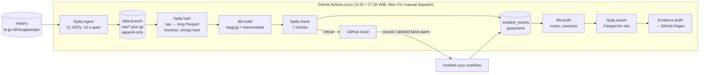

# Design — harga-pangan-dq

Status: **accepted** (2026-11-12). Sections are updated as milestones learn more; changes are noted
inline with the milestone that made them.
Source decision (Phase 0, approved 2026-11-12): PIHPS Nasional is the only source; traditional
markets only; no second source, so check #7 reconciles within PIHPS; no email to BI.
See [phase0-source-discovery.md](phase0-source-discovery.md).

## 1. Architecture



Key properties:

- **Raw is the source of truth.** The DuckDB warehouse is rebuilt from raw on every run, which takes
  seconds at this volume. It is never committed.
- **Checks sit between intermediate and marts.** Critical findings quarantine their scope (a cell,
  a commodity-day or a whole day), so bad values never reach the published marts. The previous good
  values stay visible, and the health panel says why.
- **The health panel is always published**, even when prices are blocked.

## 2. Ingestion and storage

### Request plan

- Endpoint: `GET /hargapangan/WebSite/TabelHarga/GetGridDataKomoditas`.
- Parameters: `price_type_id=1` (traditional market), `comcat_id=com_N`, `tipe_laporan=1` (daily),
  and a window from `start_date` = D−7 calendar days to `end_date` = D.
- **21 requests per run**, one per commodity. Each response contains the national row and every
  province. The 7-day window picks up late data and revisions (BI allows revisions until D+1) at no
  extra request cost.
- Reference lists (`GetRefCommodityAndCategory`, `GetRefProvince`): 2 extra requests per run. They
  are inputs to the schema-drift and unit checks.
- City-level rows (`showKota=true`) come in the same request. *Verified in M1:* one response for
  Cabai Merah Besar held 1 national row, 27 province rows and 90 city rows (`level` 0/1/2).
  - **A city row does not name its province.** Its parent is the nearest province row above it, so
    the parser must keep row order (it does: `row_idx`).
  - A province value equals the mean of the cities that reported that day, rounded to Rp 50. This
    held for 741 of 741 non-missing province-days in the M1 fixtures. Examples:
    - Papua on 2026-11-10: (120,000 + 165,000 + 90,000 + 52,500 + 111,250) / 5 = 107,750;
    - Kalimantan Barat: 84,583 → 84,600.
  - Consequences: a 38-province re-aggregation is reproducible (ADR-006), and check #7 gains a
    second reconciliation (province vs its cities).
- Politeness:
  - ≥3 s between requests, sequential;
  - 3 retries with backoff (5/15/45 s) on 5xx and timeouts;
  - **stop the run on 403/429**;
  - hard cap of 60 requests per run;
  - User-Agent `harga-pangan-dq/<version> (+https://github.com/ExHansen/harga-pangan-dq)`.

### Schedule (cron is UTC; WIB = UTC+7, no DST)

| Run | Cron (UTC) | WIB | Purpose |
|---|---|---|---|
| main | `20 7 * * 1-5` | 14:20 | 80 min after BI's 13:00 publication target. Off the hour, because GitHub delays jobs at :00. |
| retry | `20 10 * * 1-5` | 17:20 | Late data; freshness and completeness escalate to critical from here |
| next day | (main run of D+1) | — | Its D−7..D window re-reads D, so revisions and late provinces auto-resolve incidents |

Both runs also run on Indonesian holidays. The calendar decides whether data was *expected*.
GitHub may drop scheduled jobs under load, so the reliability report counts **expected runs that
never happened** as failures (see §7).

### Storage: an orphan `data` branch in the public repo (recommended, see ADR-002)

*Layout as implemented in M1.* `fetched=` is the WIB date of the fetch; stamps are UTC.

```
raw/pihps/komoditas/price_type=1/fetched=2026-11-12/com_13__20261104-20261111__k1__20261112T104950Z__67d124ec69d9.json.gz
raw/pihps/komoditas/price_type=1/fetched=2026-11-12/com_13__20261104-20261111__k1__20261112T104950Z__67d124ec69d9.meta.json
raw/pihps/ref/fetched=2026-11-12/commodities__20261112T104946Z__af6439603c17.json.gz (+ .meta.json)
manifest/20261112T104946Z__<run_id>.jsonl    one line per request: params, status, sha, bytes, stored|dedup|failed|refused|skipped
state/runs/…, state/incident_events/…, state/quarantine/…   (from M3/M4, same one-file-per-run rule)
```

- **Raw file name:** `<request key>__<fetch time>__<sha256[:12]>`.
- **The body is stored byte-exact**, gzipped deterministically (`mtime=0`, no embedded name).
- **The sidecar `.meta.json` holds the provenance:** full parameters, fetch time, HTTP status,
  content type, full SHA-256, size, attempts, User-Agent, run id and client version.
- **Immutable and append-only.**
  - Files are created via a temp file and a hard link, which fails if the target exists, so nothing
    is ever overwritten.
  - `hpdq raw verify` re-hashes every file against its name and sidecar.
  - `--git-staged` fails if the staged commit modifies, deletes or renames anything
    (`git diff --cached --diff-filter=MDRTCUXB`).
- **Idempotent.** A response identical to the *latest* snapshot of the same request is not stored
  again. Re-running a day when the source has not changed adds **no raw files and produces identical
  marts**. It only writes that run's manifest, because a re-run is itself an event worth logging.
  This is shown in M1: the second run stored 0 of 6.
- **Revisions are visible.** If BI changes a past value, the next fetch has a different hash and
  becomes a new snapshot. Comparing with the *latest* snapshot (not any earlier one) keeps a revert
  A → B → A as three snapshots in time order. Staging keeps the latest snapshot per
  (date, commodity, area) and counts the revisions.
- Volume: about 21 small gz files per run day, roughly 5–30 MB/year including city rows. Fine for git.

### Backfill

*Revised in M2 after measuring.* The estimate above of ~190 requests (one per year per commodity)
was wrong. A one-year window **timed out** (> 30 s) on three attempts before I stopped it, while
the measured server times on 2026-11-12 were:

- 8 days: ~3 s;
- 31 days: ~5 s;
- the 83 monthly requests of the M2 bootstrap: median 4.1 s, max 6.6 s.

So backfill works in **calendar-month windows**:

- `hpdq backfill --start … --end …` sends one request per commodity per month.
- It is gentler than daily ingestion: ≥ 8 s between request starts (the source idles ~3 s between
  queries), and at most one retry after 30 s.
- It is resumable: a window whose snapshot already exists is not requested again (shown in M2:
  "already stored 1").

Volume:

- **M2 bootstrap:** 2026-08-01 → 2026-11-11, 84 requests (83 new), all 200 OK, no retries.
- **Full history** (M6): Jan 2018 → Jul 2026 is about 103 months × 21 ≈ **2,160 requests**, about
  4.8 h at 8 s each. It runs as several night-time (WIB) `workflow_dispatch` runs of a few hundred
  requests each, so the bot pushes the data, not me.

## 3. Modelling (dbt-duckdb)

Python parses raw into a **lossless long table** (`raw_cells`), one row per (snapshot, row, field)
with the value as JSON text. It does **no type conversion**: a bad value should be visible to the
validity check, not crash the parser. Unknown fields stay in `raw_cells` and in the snapshot
fingerprint for the schema-drift check.

*As built in M2* (descriptions, types and grain: [data-dictionary.md](data-dictionary.md),
generated):

| Layer | Models |
|---|---|
| seeds | `provinces`: 38 provinces, ISO 3166-2 code, English name, ISO geographical unit as island group, `split_from`, law.<br>`pihps_province_map`: 34 source provinces → 38, `one_to_one` / `split`.<br>`pihps_split_cities`: the 7 cities of the split provinces → current province.<br>`commodities`: names, unit, plausible range derived from data. |
| staging (views) | `stg_pihps__snapshots`: request params.<br>`stg_pihps__grid_rows`: area type; a city's parent province comes from row order; `area_key`.<br>`stg_pihps__prices`: `"16,500"` → 16500, `"-"` → `is_missing`, raw text kept.<br>`stg_pihps__ref_commodities`, `stg_pihps__ref_provinces`. |
| intermediate | `int_prices__current`: latest snapshot per (commodity, date), revision flags (ADR-015).<br>`int_prices__series`: one model for national, province and city series. It computes previous observation, day-over-day %, week-over-week % (ASOF, ≤ 14 days), log return and `volatility_20`. |
| marts (contracts enforced) | `fct_price_daily`: date × commodity × source province, with the gap to national.<br>`fct_price_national_daily`: with `provinces_reporting`.<br>`fct_price_city_daily`: each city in its current province, for a true 38-province view.<br>`agg_volatility`: last 60 observations per series.<br>`dim_commodity`, `dim_province` (38), `dim_source_province` (34). |

- `calendar_holidays` and `seasonal_windows` moved to M3, where the checks that use them are built.
- *M3 note:* the marts will exclude quarantined scopes.
- **Tests:**
  - custom generic tests (`unique_combination`, `positive`, `dbt_expression_is_true`), with
    **no dbt packages**;
  - 4 singular tests that guard the reference data against the source's own lists;
  - 2 **dbt unit tests** on synthetic rows: latest-snapshot-wins, and weekend/ASOF changes;
  - an enforced contract on every mart, shown to fail on a type change (`price_idr` declared
    `integer` → "data type mismatch").
- **Two different jobs:** dbt tests answer "is my transformation correct?". The DQ checks answer
  "can I trust the source today?".

*Facts measured on the M2 data* (21 commodities, 74 business days, 2026-08-03 → 2026-11-12):

- **Province = mean of its reporting cities, rounded to Rp 50:** 50,979 of 50,979 province values
  hold, with no exceptions. This is check #7a in M3.
- **Revisions:** 0 of 50,979 province values changed between overlapping fetches. It is still
  tracked (`is_revised`).
- **Names:** 123 published names carried trailing spaces. Staging trims them and keeps
  `area_name_raw`.
- **Coverage:** all 34 source provinces appear; the split-province cities are exactly the 7 in the
  seed.

## 4. Data-quality checks

All checks run against intermediate models. "Critical" means the check quarantines its scope and
opens a GitHub Issue. "Warning" means the data is published and the finding is logged.

| # | Check | Business reason | Rule | Severity |
|---|---|---|---|---|
| 1 | Freshness | Showing yesterday's prices as today's misleads readers | On an expected publication day (weekday, not in `calendar_holidays`), the national row for D has ≥1 non-missing price by **14:00 WIB**. **Stale re-delivery** sub-rule: the share of unchanged D-vs-D−1 cells for volatile commodities (chilli, shallot) is above its historical 99.5th percentile. | Missing: warning before 17:00 WIB, **critical** after. Stale: **critical**, blocks D. |
| 2 | Completeness | Missing provinces bias comparisons and national gaps | Expected set = (commodity, province) combinations that reported on ≥80% of the last 40 business days. This is learned, because only 27/34 provinces report some commodities. | Warning; **critical** if a whole province is missing or completeness is <80% after 17:00 WIB. Gaps stay gaps (nothing is imputed). |
| 3 | Validity | Wrong numbers are worse than missing ones | The price string parses to an integer > 0 and lies in the commodity's plausible range (seed, set from history with a wide margin). The ref denomination equals the expected unit. | **Critical**: quarantines the cell (parse or range) or the commodity-day (unit) |
| 4 | Duplicates | Double rows double-count in averages | (commodity, area, date) is unique within a snapshot | Identical duplicates: warning + dedupe. Conflicting duplicates: **critical**, quarantines the commodity-day. |
| 5 | Schema drift | An undocumented endpoint can change silently | The response fingerprint matches the versioned contract in the repo: top-level keys, row keys, date-key format, `level` values, number format, the commodity id/name/unit list and the province name list | **Critical**: the parser refuses unknown shapes for that endpoint and run |
| 6 | Anomaly | Separate a real price shock from a data error | See below | `likely_error`: **critical**, quarantines the cell. `likely_real` / `unexplained`: warning. |
| 7 | Reconciliation (internal) | The source's figures at different levels should tell the same story | (a) **Province vs its cities:** the province value equals the mean of its city rows within Rp 50 rounding (verified in M1). A break means a partial or inconsistent publication. (b) **National vs provinces:** the ratio of the national row to the mean of the provinces, per commodity, stays inside its trailing robust band. The two are computed differently (national = average over all traders), so this uses a band, not equality. | (a) **critical** for that province-day; (b) warning |

### How the anomaly check tells a real move from a data error

1. **Detect.** Per commodity × province, compute r = ln(p_t / p_prev) over business days.
   - Robust z = (r − median) / (1.4826 · MAD) over the trailing 60 observations.
   - PIHPS prices are sticky, so MAD is often 0. The scale is therefore floored at the commodity's
     pooled scale across provinces and a minimum % per volatility class.
   - Gaps longer than one business day (for example the Lebaran break) widen the threshold by √gap.
   - A move is flagged when |z| exceeds the threshold **and** |r| exceeds the floor.
2. **Classify each flagged move** using the context on the same day:
   - **Neighbours:** the median change of the other provinces in the same island group.
   - **National trend:** the change in the national row.
   - **Decimal signature:** p_t / p_prev ≈ 10^k (×10 is kg↔ons, ×1000 is a typo).
   - **Season:** the date falls in a `seasonal_windows` window (Ramadan → Lebaran, Christmas–New Year).
3. **Decide:**
   - `likely_error` if there is a decimal signature, **or** the move is isolated (neighbours and the
     national row flat, |z| very high) outside a seasonal window.
   - `likely_real` if neighbours **or** the national row move the same way by a meaningful fraction,
     or if it is a same-direction move inside a seasonal window.
   - `unexplained` otherwise, which goes to a human through the warning list.
4. **Re-classify the next day.** If the price snaps back to the old level on D+1, an `unexplained`
   move is upgraded to `likely_error` (typo signature).

Lebaran spikes are broad: many provinces move together and so does the national row, so they come
out as `likely_real`. M6 measures this on 2018–2026 Lebaran windows and publishes how many flags
were classified each way. The thresholds are calibrated on that history, not guessed.

### Incident lifecycle (append-only event log)

- `incident_events` columns: `event_id`, `incident_id`, `event_type` (opened / resolved /
  false_alarm_marked / issue_linked), `at`, `check`, `severity`, `scope` (JSON), `business_date`,
  `evidence` (JSON), `status`, `resolved_at`, `resolution`, `false_alarm`, `run_id`, `issue_number`.
  The `incidents` view is the latest event per `incident_id`.
- `incident_id` = hash(check, scope, business_date). A problem that persists across runs is **one**
  incident, not one per run.
- **Auto-resolve:** when a later run evaluates the same scope and it passes (for example the late
  province arrived), a `resolved` event is appended and the issue is commented on and closed.
- **Human resolve:** closing the GitHub Issue triggers `incident-sync.yml`, which appends `resolved`
  with the closing comment as the resolution. The label `false-alarm` sets `false_alarm = true`.

## 5. Fault injection

`hpdq faults run --day <D>` copies the raw snapshots up to D into a temp workspace. It corrupts D's
snapshot at the **raw level**, where real faults happen, then runs load → dbt → checks.

| Fault | Mutation | Expected to catch |
|---|---|---|
| missing province | drop one province row from every commodity response | Completeness |
| duplicated rows | duplicate province rows, with identical and conflicting variants | Duplicates |
| unit change kg → ons | divide one commodity's prices by 10 and set its ref denomination to `ons` | Validity (unit), Anomaly (decimal signature) |
| price ×1000 | multiply one cell by 1000 | Validity (range), Anomaly |
| stale day | D's column carries D−1's values | Freshness (stale re-delivery) |
| renamed column | `name` → `nama` | Schema drift |

- The clean run of the same day must produce **0 incidents**, using a fixed golden day in the
  fixtures.
- For each fault, the results record: detected (yes/no), which checks fired, severity, whether D was
  quarantined, and collateral incidents.
- The output goes to `docs/results/fault-injection.md` and into the README between generated markers.
- It also runs **offline in CI on every push** against recorded fixtures, so a regression in a check
  fails the build.

## 6. Dashboard

**Evidence**, built after every run and deployed to **GitHub Pages**
(`https://exhansen.github.io/harga-pangan-dq/`). The site reads Parquet exported from the marts,
incidents and runs.

Pages:

- **Latest prices:** a table plus a ranked bar chart per commodity.
- **Commodity trends:** lines per province with the national line.
- **Data health:** last update, freshness, completeness %, incidents in the last 30 days.
- **Incident log**.
- **About:** method and limits.

Every page carries the citation and "not an official statistic" in a shared footer. A ranked bar
chart is used instead of a map in the MVP: 34-province data on a 38-province map would need a
boundary decision and a GeoJSON licence check.

## 7. Reliability metrics (definitions fixed before the clock starts)

| Metric | Definition |
|---|---|
| Days running | Calendar days from the first successful scheduled run after M4 to the report date |
| Run success rate | Successful scheduled runs ÷ **expected** scheduled runs. Expected = 2 per weekday, so missing or dropped runs count as failures. Manual and backfill runs are reported separately. |
| Freshness lag | Per publication day: the first run that saw D's national row, minus 13:00 WIB on D. The median is reported. The floor is ~80 min because of our schedule, which is stated. |
| Completeness | Mean daily completeness %, at the same-day 17:20 run and at the final D+1 evaluation |
| Incidents by type | Counts by check × severity, with real and injected faults separated |
| Mean time to detect | detected_at − observable_at. observable_at = fetched_at of the snapshot carrying the problem, or the 14:00 WIB deadline for missing data. |
| False alarms | Incidents with `false_alarm = true` ÷ all incidents |

`hpdq report` writes these into the README "Live results" between markers, and into
`docs/results/reliability.md`.

## 8. Decision records

**ADR-001 Source access via the page's own JSON endpoints.**

- Decided: use the public GET endpoints behind PIHPS "Tabel Harga".
- Alternatives:
  - Excel export: client-side only, same data, harder to parse;
  - Bapanas: unreachable from outside Indonesia, and its portal's robots.txt disallows `/api/`.
- Why: allowed by robots.txt; one request per commodity covers every province; the format is
  machine-readable. Undocumented, so the schema-drift check is mandatory.

**ADR-002 Storage: orphan `data` branch in the public repo.**

- Alternatives:
  - **Private data repo + deploy key.** Raw is not public, but it needs a secret. Liveness is not
    visible, and the code repo can go 60 days without activity, after which **GitHub disables cron in
    public repos**.
  - **Release assets.** Awkward to append daily; limit of 1000 assets per release.
  - **Cloudflare R2.** Free tier, but needs an account with a payment method.
  - **Actions artifacts/cache.** Expire after 90 days or less.
- Why: free, no secrets (`GITHUB_TOKEN`), git history is visible proof of append-only, and daily bot
  commits count as repository activity.
- Trade-off, stated honestly: this republishes BI's raw responses in public. In Phase 0 I suggested
  keeping raw private. On reflection, the dashboard has to publish the full province × commodity
  daily series anyway, so hiding raw adds little legal protection and costs reproducibility.
  Mitigations: citation and a non-commercial statement in the data branch README; takedown on
  request. **Your call.**

**ADR-003 Rebuild the warehouse from raw every run** instead of incremental models.

- Why: idempotent by construction and simplest to reason about. Thousands of rows per day make a full
  rebuild cost seconds.

**ADR-004 Lossless Python parser, typing in dbt.**

- Why: parsing errors become visible data (validity incidents), not crashes. The SQL shows every
  cleaning rule.

**ADR-005 34 source provinces + explicit mapping to 38.**

- Decided: model what the source publishes (34). A seed maps old Papua to Papua, Papua Tengah,
  Papua Pegunungan and Papua Selatan, and old Papua Barat to Papua Barat and Papua Barat Daya, with
  the 2022 laws and the sample cities as evidence. No silent re-assignment.

**ADR-006 Store city-level rows in raw from day one.** *Confirmed in M1.*

- Why: no extra requests, and it keeps a true 38-province re-aggregation possible later without
  re-fetching history.
- Cost: about 4× larger responses (~20–25 KB per commodity for an 8-day window), still small.
- M1 also showed the source's province value is the mean of its cities rounded to Rp 50, so the
  re-aggregation is faithful.

**ADR-007 Evidence for the dashboard.**

- Alternative: Observable Framework. It is more flexible, but its last commit was May 2026, while
  Evidence was pushed 2026-11-12.
- Why: SQL-and-Markdown pages fit a Data Analyst portfolio; it has built-in tables and charts and
  produces a static build.

**ADR-008 GitHub Pages** over Cloudflare Pages.

- Why: same repo, deployed by Actions, no extra account or token.

**ADR-009 WIB as a fixed UTC+7 offset.**

- Why: Indonesia has no DST, and `zoneinfo` on Windows needs the `tzdata` package. A fixed offset
  avoids the dependency.

**ADR-010 Severity = quarantine scope, not stop the world.**

- Why: one ×1000 typo should not hide 700 good prices. Critical findings exclude their scope; the
  dashboard shows the exclusion.

**ADR-011 Incidents as an append-only event log.**

- Why: the brief requires append-only. Status, resolution and false-alarm are new events; the current
  state is a view.

**ADR-012 (M1) Lossless loader: Python fingerprints, DuckDB flattens.**

- Decided:
  - Python inspects each payload's shape (`hpdq.load.inspect`) and never raises on bad input.
  - DuckDB SQL (`read_json_objects` + `json_each`) unpivots every valid snapshot into
    `raw_cells(snapshot_id, row_idx, field, value_json, value_type, value_text)`.
- Alternatives:
  - parse and insert row by row in Python: slow without pandas or pyarrow;
  - `read_json` with an inferred schema: the date keys become hundreds of columns.
- Why: a test proves the round trip — every row of every fixture is rebuilt exactly from the cells.

**ADR-013 (M1) Provenance in a sidecar, not an envelope.**

- Decided: the raw body is stored exactly as received, and the metadata goes in a separate
  `.meta.json`.
- Why: the stored bytes hash to the same SHA-256 as the response itself, so anyone can verify a file
  without our code.

**ADR-014 (M2) Stay on dbt Core 1.12 + dbt-duckdb, not dbt v2.**

- Context: dbt now ships a "v2". It is a Rust rewrite with a new PyPI name (`dbt`) and its own
  licence. Its DuckDB support is CLI-only, and local unit tests are experimental. The docs say v1.x
  "remains fully supported".
- Decided: dbt-core 1.12.7 + dbt-duckdb 1.11.1, pinned exactly. This was approved in the design.
- Why:
  - in-process `dbtRunner` (no subprocess);
  - mature external Parquet sources;
  - unit tests and contracts work today;
  - Apache-2.0.
- Revisit when v2's DuckDB adapter leaves CLI-only.

**ADR-015 (M2) Latest snapshot per (commodity, date), not per cell.**

- Decided: for each (price type, commodity, date), all areas come from the most recently fetched
  snapshot that contains that date.
- Alternative: latest value per cell. That mixes publications, and a value the source later removes
  would survive forever.
- Why: the marts show exactly one publication of the source per date. Revisions stay visible
  (`is_revised`, `n_snapshots`). Proven by a dbt unit test.

**ADR-016 (M2) dbt runs in-process and leaves no state behind.**

- Seeds are `full_refresh: true`. dbt-duckdb loads seeds with `COPY` into the existing table, so a
  new seed column failed against an older warehouse; this was seen in M2 and fixed this way.
- After every invocation, `run_dbt` closes dbt-duckdb's cached DuckDB environment. Otherwise the
  next connection in the same process (the checks in M3, the tests) is refused with "different
  configuration than existing connections".
- All dbt output (warehouse, `target/`, logs) goes under `./build`.

**ADR-017 (M2) The data dictionary is generated.**

- `hpdq docs` renders [data-dictionary.md](data-dictionary.md) from the dbt manifest: descriptions,
  types, and grain (taken from `unique_combination` tests).
- Tests fail if a mart or seed column has no description, if a seed column is undeclared, or if the
  committed file is stale.

## 9. Dependencies (approval requested)

| Purpose | Package | Pin (latest checked 2026-11-12) |
|---|---|---|
| CLI | typer | 0.29.x |
| HTTP | httpx | 0.28.1 (its `MockTransport` replaces a mocking library) |
| Warehouse / Parquet | duckdb | 1.5.x (dbt-duckdb's own tested pin; 2.0.0 came out on 2026-10-21, so I'll try it in M2) |
| Modelling | dbt-core, dbt-duckdb | **1.12.7 / 1.11.1**, pinned exactly in `pyproject.toml` (M2) |
| Dev | pytest, ruff, mypy | 9.2 / 0.17 / 2.4 |
| Dashboard (M4) | Evidence (npm template) | 40.x |
| Analysis charts (M6, optional group) | matplotlib | 3.11 |

Not used: pandas, pyarrow (DuckDB reads and writes Parquet), tenacity (a 15-line retry loop),
dbt packages, pytest-socket (a conftest guard blocks network in tests). The only secret is the
built-in `GITHUB_TOKEN`.

*M1 note:*

- Build backend: `hatchling`. It is build-time only and is not installed with the package.
- typer 0.29 pulls in `rich`, `shellingham`, `pydantic` and `annotated-doc`, all pinned in `uv.lock`.
- The CI actions are pinned to commit SHAs: `actions/checkout` v7.0.1, `astral-sh/setup-uv` v10.3.3.

## 10. Risks

| Risk | Mitigation |
|---|---|
| BI blocks datacenter IPs (F5 `TS…` cookie seen) | Freshness incidents make it visible within one run. Fallback: a self-hosted runner, which would be your decision. |
| The undocumented endpoint changes | Schema-drift check, recorded fixtures, a parser contract file |
| GitHub delays or drops cron runs | Off-hour schedule, a retry run, missed runs counted as failures |
| An incomplete holiday seed causes freshness false alarms | Recorded as `false_alarm` and reported. The seed is updated from the SKB *cuti bersama* decree. |
| Licence (all rights reserved) | Non-commercial, cited on every page, not an official statistic, takedown on request |
| No external dead-man's switch | Missed runs are detected on the next run, and GitHub emails on workflow failure. Optional: healthchecks.io, an external service that would need your approval. |
